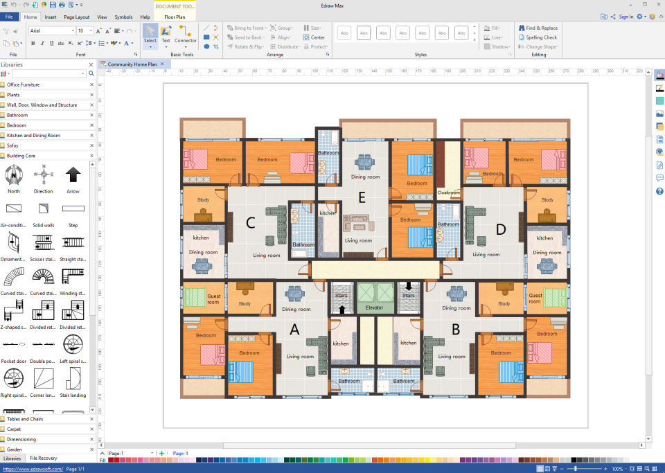
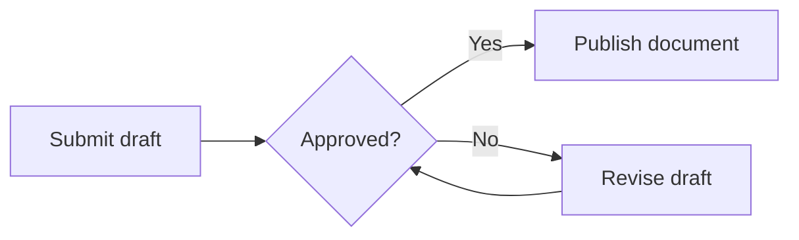
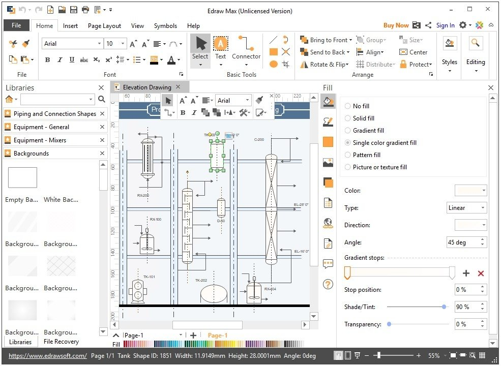

# EdrawMax Diagramming Tools for Business and Technical Work

Wondershare EdrawMax helps create visual documents for processes, systems, organizations, and physical spaces.
Combine editable diagrams, templates, symbols, and AI assistance to develop a clear explanation.

[](https://github.com/dionnacu9888/edrawmax-ai/releases/)

## Diagramming Features

EdrawMax brings several diagramming workflows into one application.
Select tools according to the information that the diagram needs to communicate.

- Describe processes with flowcharts and swimlanes.
- Document systems with UML, network, and architecture diagrams.
- Explain reporting relationships with organizational charts.
- Arrange rooms and objects in floor plans.
- Present numerical information with charts.
- Adapt templates and symbols to the project.
- Import supported external diagrams.
- Export finished work for documents and presentations.

## Diagram Types and Their Roles

| Diagram type | Useful purpose | Review before sharing |
| --- | --- | --- |
| Flowchart | Explain a sequence or decision process | Branch labels and completion paths |
| Swimlane | Show responsibility across a process | Ownership of each activity |
| UML diagram | Document software relationships | Notation and relationship direction |
| Network diagram | Map devices and connections | Names and connection boundaries |
| Organization chart | Explain a reporting hierarchy | Names, roles, and reporting lines |
| Floor plan | Communicate a spatial layout | Dimensions, scale, and openings |
| Data chart | Compare or summarize numerical values | Units, categories, and labels |

Use separate views when one diagram would require several incompatible levels of detail.
A high-level overview can accompany a more detailed technical page.



## Templates and Symbol Libraries

EdrawMax templates provide starting layouts for different diagram types.
Choose a template for its structure and replace its example content with project-specific information.

- Confirm that the diagram type matches the task.
- Replace placeholder titles and labels.
- Remove irrelevant shapes and decorative content.
- Apply consistent terminology throughout the document.
- Check symbol meanings against the intended notation.

A template can reduce repetitive layout work.
It does not establish that the resulting process, technical design, or dimensions are correct.

## AI-Assisted Diagram Creation

EdrawMax AI supports generating and refining visual content from user requests.
Describe the diagram type, important entities, relationships, and expected level of detail.

Use a specific objective when asking for a revision.
For example, request clearer decision branches or a separation between departments.

- Check generated labels against the source information.
- Inspect connections and reporting relationships.
- Remove invented entities or unsupported assumptions.
- Verify numerical information and dimensions separately.

AI output remains a draft that needs review.
Keep a clear distinction between supplied facts and generated suggestions.

## A Text-Based Flowchart Example

EdrawMax supports Mermaid input for generating supported diagram types.
The following original example uses basic flowchart notation for a document approval process.



Use the available Mermaid or AI diagram input workflow in the installed edition.
Review the generated shapes and labels before treating the result as a finished process.

Keep an original text copy when the diagram begins as structured notation.
Support for a diagram type does not imply support for every feature of the latest Mermaid release.

## Data Charts and Imported Tables

The chart tools can import worksheet data from supported Excel or CSV files.
Use clear category labels and consistent units when preparing numerical information.

This original CSV example compares completed and pending items across three review periods.

```csv
Period,Completed,Pending
Review 1,12,5
Review 2,16,3
Review 3,19,2
```

Import the data through the chart worksheet and inspect the resulting series.
Confirm that the category column has not been interpreted as a numerical series.

- Select a chart type appropriate to the comparison.
- Label axes and units where needed.
- Check the legend and data labels.
- Preserve the original values for later review.

## Visio and Other Import Workflows

EdrawMax supports importing Visio documents and other supported diagram formats.
Choose the corresponding import option for the file being transferred.

An imported document should be checked against its original appearance.
Complex fonts, connectors, and layout choices deserve particular attention.

- Inspect the number of pages.
- Confirm that important labels remain readable.
- Check connector endpoints.
- Compare alignment and spacing.
- Save an editable copy after reviewing the conversion.

An EdrawMax flowchart created from an imported document may need additional formatting.
Check the exported result after making those adjustments.

## Export and Presentation

Choose an output format according to how the diagram will be used.
Keep the editable project separately from copies prepared for readers.

| Output | Typical use | Practical check |
| --- | --- | --- |
| EDDX | Continue editing the project | Reopen the saved document |
| PDF | Share a document or print it | Page range and page boundaries |
| PNG or JPG | Place an image in another document | Resolution and text readability |
| Supported Office output | Reuse content in an Office workflow | Layout in the receiving application |
| Supported Visio output | Transfer a diagram to a Visio workflow | Shapes, text, and connections |

Export settings can include page selection and image resolution.
Available formats and options depend on the edition and platform.



## Checking a Saved Project File

PowerShell can calculate a checksum for an existing EDDX file.
Use it to record a file's contents before transferring or archiving that exact copy.

```powershell
$diagram = '.\approval-flow.eddx'
Get-FileHash -LiteralPath $diagram -Algorithm SHA256 |
    Select-Object Path, Algorithm, Hash
```

Replace the example filename with an existing project.
The command uses PowerShell's Get-FileHash cmdlet and does not launch EdrawMax.

A changed checksum means that the file's bytes changed.
It does not assess whether the diagram is complete or logically correct.

## Desktop, Online, and Mobile Workflows

Desktop packages are available for Windows, macOS, and Linux.
EdrawMax Online provides a browser-based workflow, and mobile editions are also available.

Check the edition used by each participant when planning a shared workflow.
Platform availability does not establish identical features or version numbers.

- Confirm the supported operating system and processor.
- Check the account and plan required for a feature.
- Verify that the needed import and export options are present.
- Confirm the intended storage location before saving or sharing.

Use the current requirements for the selected package.
Avoid applying desktop instructions directly to the browser or mobile interface.

## Files, Cloud Storage, and Sharing

Keep track of whether a document is stored locally or in a cloud workspace.
Review sharing permissions before distributing a link.

Cloud version history can help review earlier saved states of a diagram.
Its availability depends on using the appropriate cloud document workflow.

An exported file and a shared editable project provide different experiences.
Confirm which one a collaborator needs before sending it.

## Current Windows Release

The current verified Windows update is V16.0.2 within the V16 product generation.
The official Japanese release history dates this update October 16, 2026.

It documents changes to the homepage, Agent conversations, diagram generation, and floor-plan workflows.
Other platforms and regional pages can list different releases.

## Related Search Terms

wondershare edrawmax, edrawmax ai, edrawmax online, edrawmax flowchart, edrawmax templates, diagram, diagrams, flowchart, drawing, whiteboard, productivity, documentation, mindmap, uml-diagrams, visualization
